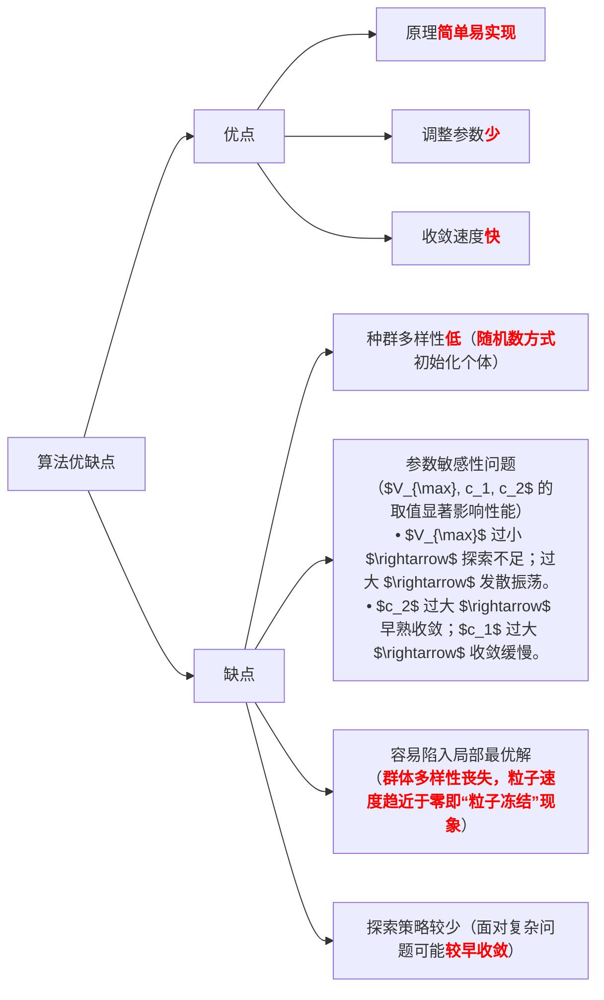

![[Pasted image 20260828201103.png]]

定义：一个族群有N个个体，一个个体有d个维度
$$
\begin{pmatrix} X_1(x,y) \\ X_2(x,y) \\ ...  \\X_N(x,y) \end{pmatrix}
$$
1. 随机生成init值
$$
X_0 = rand(0,1)*(UB-LB)+LB
$$
2. 计算个体适应度：验算候选解，记录最远解
$$
\begin{cases}
筛选个体极值=P_i=(P_{i1},P_{i2},...,P_{iD})^T \\
筛选群体极值=P_g=(P_{g1},P_{g2},...,P_{gD})^T
\end{cases}
$$

### 公式
![[Pasted image 20260830120440.png]]
- c_1/c_2：个体/社会认知因子
- r_1/r_2：randon(0,1)

![[Pasted image 20260828201124.png]]